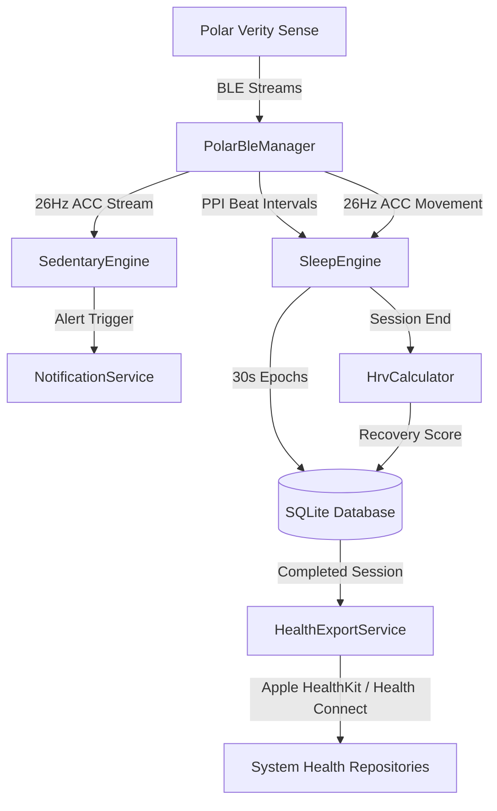

# PolarSense Extension 🏃‍♂️💤

A cross-platform Flutter application extending the **Polar Verity Sense** optical heart rate and 3-axis accelerometer sensor.

Built to address feature gaps in the official Polar Flow ecosystem:
- **Sedentary Reminder (久坐提醒)**: Real-time 26 Hz accelerometer Vector Magnitude Unit ($VMU$) processing with automatic 90-second active walking reset.
- **Sleep & Recovery Monitoring (睡眠与恢复评估)**: Overnight PPI (pulse-to-pulse interval) and accelerometer epoch processing for sleep staging (Wake, Light, Deep, REM), Resting Heart Rate, HRV (RMSSD), and a 0–100 Nightly Recovery Score.
- **Health Ecosystem Sync**: Direct sync into Apple HealthKit (iOS) and Google Health Connect (Android).

---

## Architecture Overview



---

## Key Modules & Files

- `PROJECT_SPEC.md`: Technical specification and agent prompt document.
- `lib/core/ble/polar_ble_manager.dart`: Device discovery, connection management, auto-reconnect, and built-in Mock Simulator.
- `lib/core/notifications/notification_service.dart`: High-priority vibration and audio alerts for sedentary reminders and morning recovery summaries.
- `lib/core/background/background_service.dart`: Android foreground service and iOS CoreBluetooth background execution.
- `lib/core/database/health_database.dart`: High-performance SQLite database for 30s epochs and rolling 14-day baseline statistics.
- `lib/features/sedentary/sedentary_engine.dart`: Sliding 5-second window VMU calculation, 90-second continuous walking reset.
- `lib/features/sleep/sleep_engine.dart`: Clean PPI interval filtering, 30s epoch accumulation, and overnight aggregation.
- `lib/features/sleep/sleep_staging_model.dart`: Heuristic classification for Wake, Light, Deep, and REM.
- `lib/features/sleep/recovery_score_calculator.dart`: 0–100 Recovery Score composite (30% Duration + 30% Stage Ratio + 40% HRV).
- `lib/features/health_sync/health_export_service.dart`: Batch export to Apple HealthKit & Health Connect.
- `lib/presentation/`:
  - `home/home_screen.dart`: Main dashboard with live sedentary timer and sleep quick toggle.
  - `device/device_screen.dart`: Sensor pairing, RSSI, battery, and Developer Simulation switch.
  - `sleep/sleep_screen.dart`: Interactive Hypnogram step chart (`fl_chart`), stage distribution, and recovery breakdown.
  - `settings/settings_screen.dart`: Threshold adjustments and ecosystem permissions.

---

## Getting Started

### 1. Prerequisites
- Flutter SDK 3.16+ (Dart 3.2+)
- Xcode 15+ (for iOS) and Android Studio / SDK (for Android)

### 2. Install Dependencies
```bash
flutter pub get
```

### 3. Run the App
```bash
flutter run
```

### 4. Run Unit Tests
```bash
flutter test
```

### 5. Developer Mock Mode
No physical Polar Verity Sense sensor at hand?
Open the **Sensor** tab, toggle **Hardware Simulator (Developer Mode)** ON. You can test live sedentary tracking, switch to active walking to observe the 90-second reset in real time, and start overnight sleep sessions directly on the simulator!
